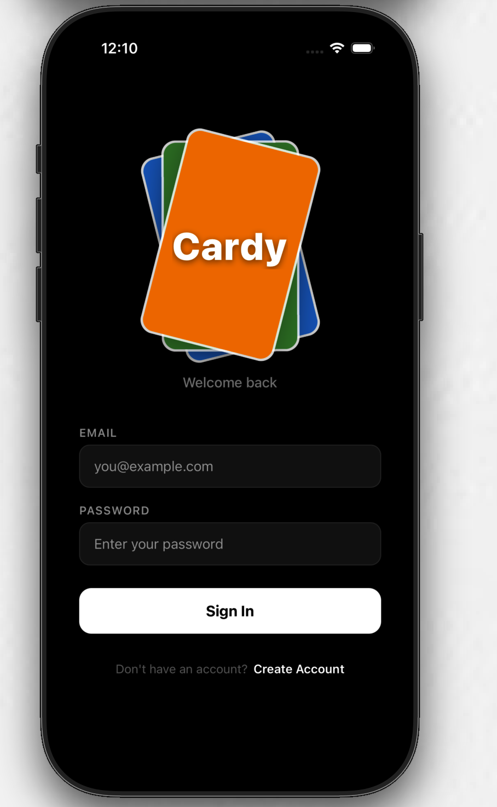
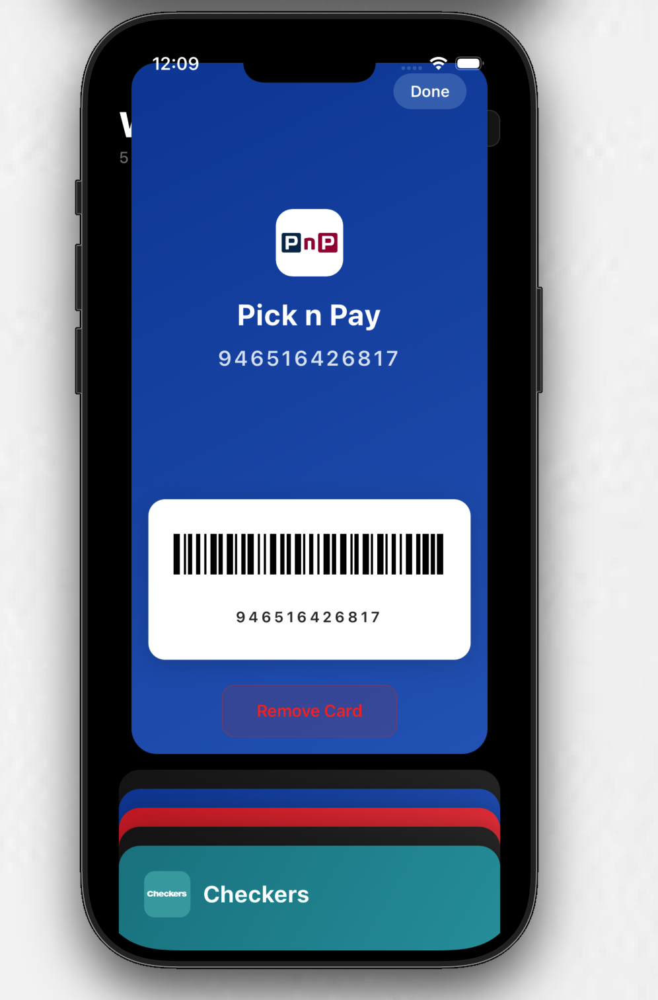

# Cardy

A mobile wallet app for storing and managing loyalty and shopping cards. Scan barcodes or add cards manually, then pull them up at checkout — no more digging through your physical wallet.

Built with React Native (Expo) on the frontend and ASP.NET Core on the backend.

## Features

- **Barcode scanning** — use your camera to scan loyalty cards and save them instantly
- **Manual card entry** — add cards by typing in the details with a custom theme color
- **Interactive card stack** — browse your cards in an animated, swipeable wallet-style UI
- **Expandable card view** — tap a card to see the full barcode, card number, and store details
- **Gesture-based navigation** — swipe down to dismiss, long-press to delete
- **Secure authentication** — JWT-based login and registration with hashed passwords
- **Per-user storage** — each user's cards are stored separately and securely in the database

## Screenshots

  
  &nbsp;&nbsp;
  
  &nbsp;&nbsp;
  
  &nbsp;&nbsp;
  

## Architecture

The app follows a client-server architecture:

- **Mobile client** — React Native (Expo) app that handles UI, barcode scanning, and card display
- **REST API** — ASP.NET Core Web API with JWT authentication and SQLite storage

  

## Technologies Used

**Frontend**
- React Native & Expo
- React Navigation
- React Native Reanimated & Gesture Handler
- Expo Camera (barcode scanning)
- Expo Secure Store (token storage)

**Backend**
- ASP.NET Core (.NET 10)
- Entity Framework Core with SQLite
- JWT Bearer Authentication
- BCrypt password hashing

## License

This project is for personal and educational use.
